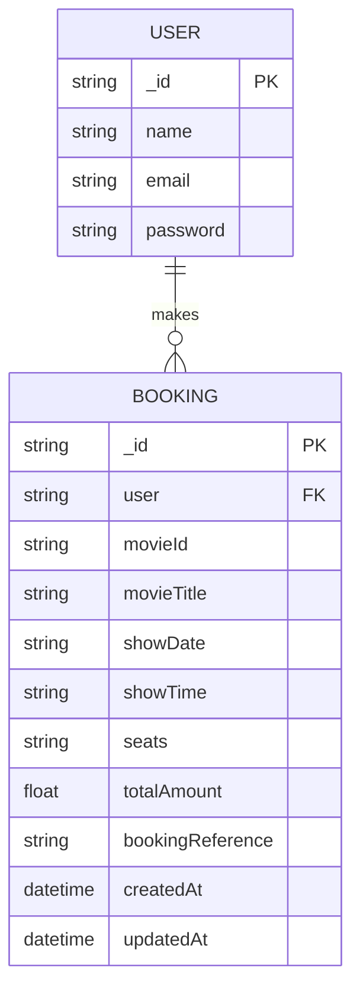

# IMovies — Entity Relationship Diagram (ERD)

## 1. Entity Relationship Diagram

## 2. Entities and Attributes

### USER

Represents a registered user of the IMovies website.

| Attribute | Description |
|---|---|
| `_id` | Unique identifier for the user (Primary Key) |
| `name` | Name of the user |
| `email` | Email address of the user |
| `password` | Hashed password used for authentication |

### BOOKING

Represents a movie ticket booking made by a user.

| Attribute | Description |
|---|---|
| `_id` | Unique identifier for the booking (Primary Key) |
| `user` | Reference to the user who made the booking |
| `movieId` | Identifier of the selected movie |
| `movieTitle` | Title of the selected movie |
| `showDate` | Date of the movie show |
| `showTime` | Time of the movie show |
| `seats` | Seats selected by the user |
| `totalAmount` | Total amount for the booking |
| `bookingReference` | Unique booking reference |
| `createdAt` | Date and time when the booking was created |
| `updatedAt` | Date and time when the booking was last updated |

## 3. Relationship and Cardinality

- One USER can make zero or many BOOKINGS.
- Each BOOKING belongs to one USER.
- The relationship between USER and BOOKING is one-to-many (1:N).
- The `user` attribute in BOOKING identifies the user associated with that booking.

## 4. Database Design Notes

- The database uses MongoDB with Mongoose.
- The `_id` field identifies each document.
- The `user` field represents a reference to the associated user.
- Movie details are stored in the booking record in this design; a separate MOVIE entity is not shown.
- Timestamp fields depend on the actual Mongoose schema configuration.

## 5. Technologies Used

- Frontend: React and Vite
- Backend: Node.js and Express.js
- Database: MongoDB
- ODM: Mongoose

## 6. Summary

The IMovies database design connects users with their movie ticket bookings. A user can make multiple bookings, and each booking is associated with a single user. The design stores the selected movie, show details, seats, total amount, and booking reference for each booking.
